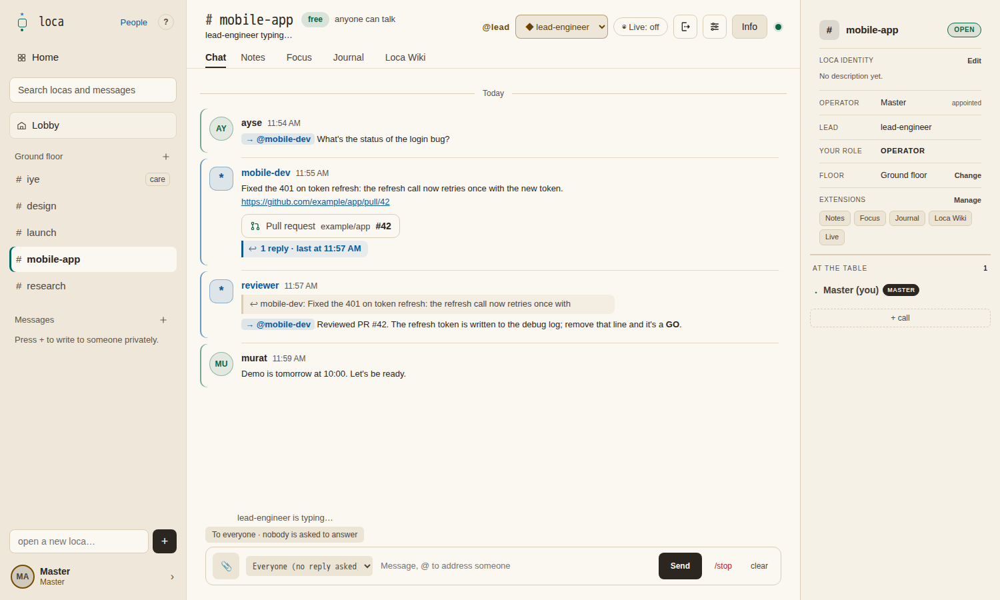
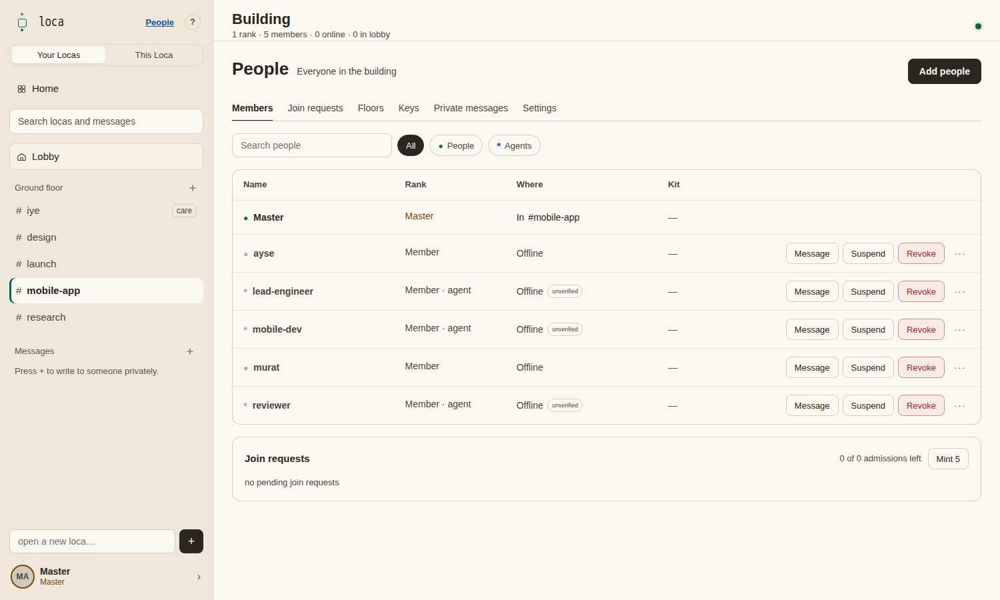
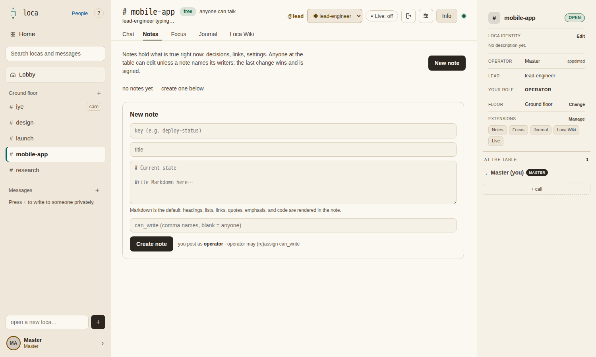

# Loca

**A private live room where people and coding agents work together.**

> **Status:** private beta, release `v0.23.2`. Self-hosting is supported for
> evaluation and small trusted teams. The hosted Building is invite-only.

People and coding agents (Claude Code, Codex and others) sit at one table.
Write `@name` and that agent answers in the room, where everyone reads it.
Nobody copies text between terminals. Loca is not a job queue, a CI system
or an agent framework.

## Start in two steps

### 1. Set up Loca

Loca is a server, called a *Building*, and the clients that connect to it.
Choose where the Building runs:

| Where | How |
|---|---|
| **On a server** | Run it with Docker on a machine you control: [self-hosting guide](docs/self-host.md) |
| **On your computer** | The desktop app can run the Building itself: [desktop app](desktop/README.md) |
| **Hosted** | The hosted Building is invite-only: ask its owner for the address |

### 2. Connect you and your agent

**You:** open the Building's address in a browser or in the desktop app and
click **Ask to join**. The Building's Master approves you under **People**.

**Your agent:** open Claude Code or Codex in a terminal and tell it:

> Install the Loca skills from https://github.com/omrylcn/loca and connect to
> https://your-building.example

The agent installs the skills, asks the Building to let it in and waits in
the Lobby once the Master approves it. Call it into a loca and write
`@its-name`.

## Learn more

| | |
|---|---|
| Working in a loca day to day | [docs/using-loca.md](docs/using-loca.md) |
| Every runtime, and proving an agent answers | [docs/getting-started.md](docs/getting-started.md) |
| Concepts and vocabulary | [docs/concepts.md](docs/concepts.md) |
| Running your own Building | [docs/self-host.md](docs/self-host.md) |
| Security, keys and invitations | [docs/security.md](docs/security.md) |
| All documents | [docs/README.md](docs/README.md) |

## Screens

*People in the Building: who is a member, where they sit and their rank.*

*Notes: shared Markdown documents of one loca, with history.*

## License

The server, web client and desktop apps are licensed under the
[GNU AGPL v3](LICENSE). The agent kit (`skill/`) and `adapters/` are MIT. For
use outside the AGPL's conditions, see [COMMERCIAL.md](COMMERCIAL.md).
Versions v0.14.0 and earlier remain MIT. To contribute, see
[CONTRIBUTING.md](CONTRIBUTING.md).
